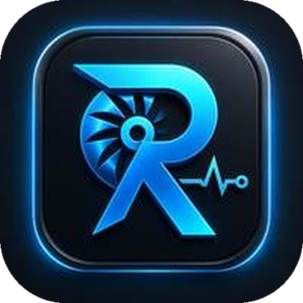
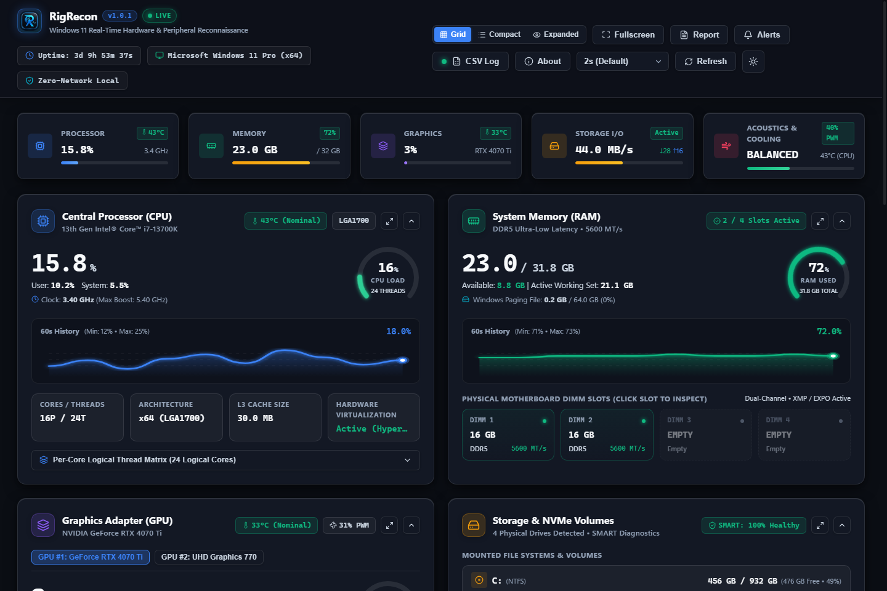
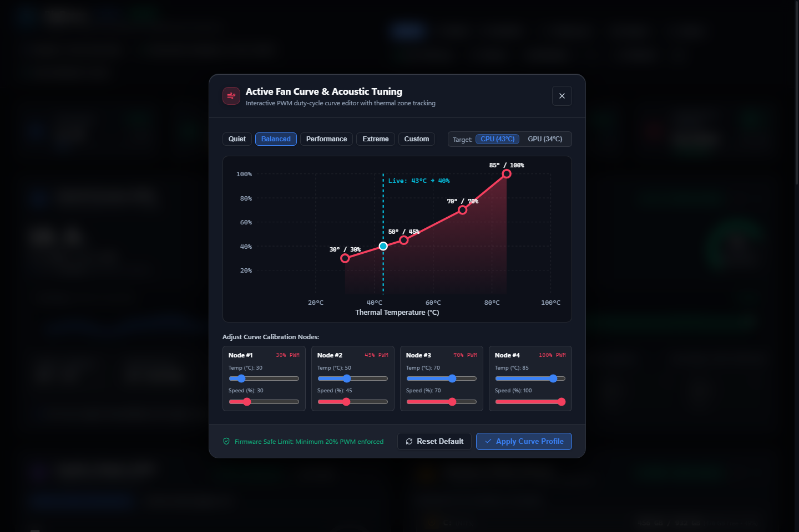
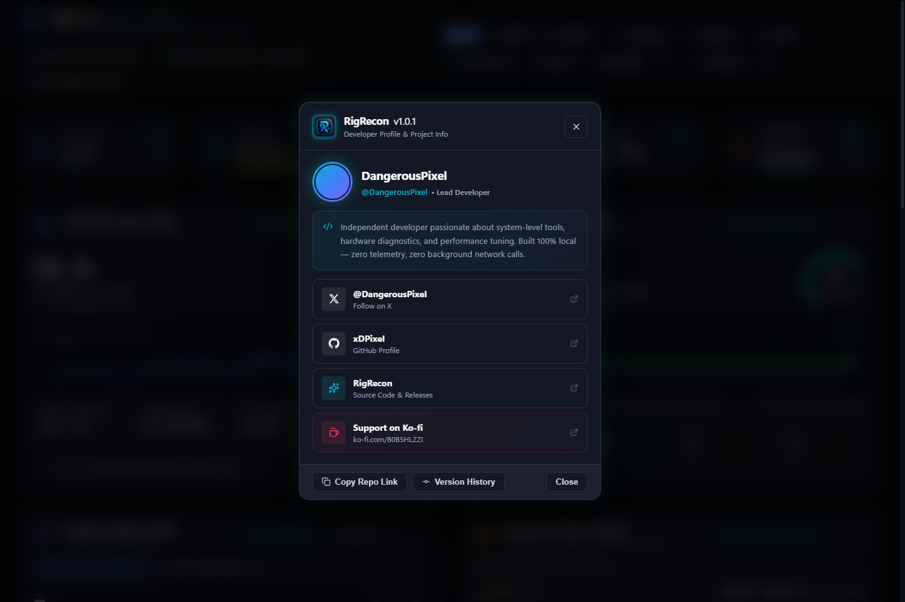

<div align="center">

  

  # RigRecon
  
  **Real-Time Windows 11 Hardware Reconnaissance & Tuning Suite**

  [](https://github.com/xDPixel/RigRecon/releases)
  [](https://github.com/xDPixel/RigRecon)
  [](https://github.com/xDPixel/RigRecon)
  [](https://ko-fi.com/B0B5HLZZI)
  [](LICENSE)

  <p align="center">
    A unified, high-performance desktop telemetry command center for PC enthusiasts, overclockers, and power users. Eliminates the need to juggle multiple disparate vendor utilities, BIOS screens, and Device Manager tabs.
  </p>

  [Download Portable (v1.0.1)](https://github.com/xDPixel/RigRecon/releases) • [Download Installer (v1.0.1)](https://github.com/xDPixel/RigRecon/releases) • [Features](#key-features) • [Security](#zero-trust-privacy--security) • [Developer](#developer--support)

</div>

---

## 📸 Screenshots & Showcase

### 1. Main Telemetry Dashboard Overview
> Dynamic telemetry cards with live sparklines, hardware status pills, KPI summary strip, and connected peripheral inventory.



---

### 2. Interactive Visual Fan Curve Tuning Suite
> Real-time acoustic and thermal tuning with live CPU/GPU temperature intersection, Bezier curve visualization, and one-click acoustic profiles (*Quiet*, *Balanced*, *Performance*, *Extreme*).



---

### 3. Developer & Project Information Mini Window
> Clean, centered developer window featuring quick-access social links, source repository, version progression history, and Ko-fi support.



---

## ✨ Key Features

- 🏎️ **Processor (CPU) Diagnostics**: Package load, clock speed (base/boost), socket, physical/logical core layout, L1/L2/L3 cache metrics, and per-core thermal tracking.
- 🎮 **Graphics (GPU) Telemetry**: VRAM usage, engine clock, memory clock, temperature, fan speed RPM/PWM, and driver version (dedicated NVIDIA/AMD and integrated Intel Iris/UHD).
- ⚡ **Memory (RAM) Inspector**: Detailed per-slot DIMM inspector with manufacturer metadata, clock speed (MT/s), part numbers, and active memory pressure metrics.
- 💽 **Storage & NVMe Health Engine**: Partition space utilization, dynamic read/write throughput (MB/s), controller temperature, and native SMART health status via hardened PowerShell queries.
- ❄️ **Fans & Acoustics Center**: 3-zone thermal tracking (AIO pump, chassis intake, GPU), real-time RPM estimation, dynamic animated fans, and custom Bezier fan curve editor.
- 🔌 **Connected Peripherals (HID)**: Live enumeration of connected USB controllers, input devices (mice, keyboards, gamepads), external DACs/audio interfaces, and connected DisplayPort/HDMI monitors.
- 📊 **Historical Telemetry Logger**: Continuous in-memory telemetry recording with RFC-4180 standard `.csv` export for benchmarking and stress testing.
- 🚨 **Configurable Alerts Center**: User-defined warning and critical thermal limits for CPU, GPU, RAM, and storage with optional desktop toast notifications.
- 📄 **Diagnostic System Report**: One-click exportable text and JSON hardware specification manifests for quick tech support and sharing.
- 🎨 **Adaptive Theming & Multi-View Engine**: Instant switching between Obsidian Dark and High-Contrast Light Fluent themes, plus *Standard Grid*, *Compact Telemetry*, and *Expanded Focus* view modes.

---

## 🔒 Zero-Trust Privacy & Security

RigRecon was designed with a strict **local-first, security-first architecture**:

| Security Principle | Implementation |
| :--- | :--- |
| **Zero External Network** | 100% offline sensor communication via native Electron IPC. Zero analytics, telemetry, or remote tracking pings. |
| **Strict Content Security Policy** | Enforces `default-src 'self'` with zero remote script execution (`script-src 'self'`). |
| **Hardened Process Isolation** | `nodeIntegration: false`, `contextIsolation: true`, and `sandbox: true` on all renderer windows. |
| **Safe External Navigation** | All popups and window-open requests are blocked; external links (Ko-fi, GitHub, X) validate schemes (`https://`) and route through `shell.openExternal`. |
| **Sanitized CLI Queries** | Disk health and SMART metrics utilize fixed-argument `child_process.execFile` calls with absolute paths to Windows PowerShell, eliminating shell injection vectors. |

---

## 🏗️ Architecture

```
┌────────────────────────────────────────────────────────┐
│                   Renderer (React 18 + TS)             │
│   Components: Header, CpuCard, RamCard, GpuCard, ...  │
└───────────────────────────┬────────────────────────────┘
                            │ Safe IPC Bridge (contextBridge)
┌───────────────────────────▼────────────────────────────┐
│                Main Process (Node.js / Electron)       │
│  ┌──────────────────┐  ┌─────────────┐  ┌───────────┐  │
│  │ systeminformation│  │  PowerShell │  │  USB/HID  │  │
│  │   (Hardware API) │  │(SMART Query)│  │(Peripher.)│  │
│  └──────────────────┘  └─────────────┘  └───────────┘  │
└────────────────────────────────────────────────────────┘
```

---

## 🚀 Getting Started

### Option 1: Pre-Built Executables (No Node.js Required)
You do **not** need Node.js, npm, or any developer tools installed on your computer.

1. Head to the [Latest Releases](https://github.com/xDPixel/RigRecon/releases) page.
2. Download your preferred package:
   - **`RigRecon 1.0.1.exe`**: Standalone portable build. Place it anywhere and run immediately.
   - **`RigRecon Setup 1.0.1.exe`**: Windows installer with desktop and Start Menu shortcuts.

---

### Option 2: Build from Source

#### Prerequisites
- Windows 10 or Windows 11 (64-bit)
- [Node.js](https://nodejs.org/) (v18 or higher recommended)
- [Git](https://git-scm.com/)

#### Clone & Install
```bash
# Clone the repository
git clone https://github.com/xDPixel/RigRecon.git

# Navigate to project directory
cd RigRecon

# Install dependencies
npm install
```

#### Run in Development Mode
```bash
npm run dev
```

#### Package Production Binaries
```bash
# Generates both Portable (.exe) and NSIS Installer in dist-releases/v1.0.1/
npm run package
```

---

## ☕ Developer & Support

Developed by **DangerousPixel** ([@DangerousPixel](https://x.com/DangerousPixel) on X).

If you find RigRecon helpful and want to support future updates and open-source hardware tools:

[](https://ko-fi.com/B0B5HLZZI)

- **X (Twitter)**: [@DangerousPixel](https://x.com/DangerousPixel)
- **GitHub**: [github.com/xDPixel](https://github.com/xDPixel)
- **Donation / Ko-fi**: [ko-fi.com/B0B5HLZZI](https://ko-fi.com/B0B5HLZZI)

---

## 📄 License

This project is licensed under the [MIT License](LICENSE).
